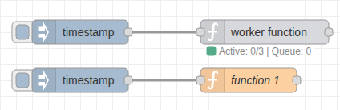

# Async Function for Node-RED

`@rosepetal/node-red-contrib-async-function` provides 1 node for Node-RED, **worker function**: a function node whose JavaScript code runs in a pool of worker threads or child processes, so CPU-intensive code does not block the Node-RED event loop.

## Installation

```bash
cd ~/.node-red
npm install @rosepetal/node-red-contrib-async-function
```

Restart Node-RED afterwards. Or search `@rosepetal/node-red-contrib-async-function` in the Node-RED Palette Manager.

The package is plain JavaScript and has no dependencies, so nothing is compiled during the installation.

## Requirements

- Node.js >= 18
- Node-RED >= 2.0.0

## Nodes

The node is in the **function** category of the palette, listed by its type name, `worker-function`. On the workspace its label is **worker function** until it is given a name.

| Node | Purpose |
|------|---------|
| **[worker-function](./worker-function.md)** | Run JavaScript, written as in the standard function node, in a fixed pool of workers, with a queue for the messages that arrive while every worker is busy |



## Quick Start

1. Add a **worker function** node to the workspace.
2. Wire an Inject node to its input and a Debug node to its output.
3. Write the code in the **Function** tab, as in a function node:

   ```javascript
   msg.payload = msg.payload * 2;
   return msg;
   ```

4. Deploy and press the button of the Inject node. The status under the node shows the workers in use and the messages waiting, for example `Active: 0/3 | Queue: 0`.

The **Setup** tab holds the number of outputs, the timeout, the runtime (worker threads or child processes), the number of workers, the size of the queue, the npm modules the code uses and the **Restart Workers** button. See [Configuration Options](./worker-function.md#configuration-options).

## When to Use It

| Use **worker function** | Use the standard function node |
|-------------------------|--------------------------------|
| Code that keeps the CPU busy: hashing, compression, parsing or transforming large data sets, numeric loops | Quick transformations: sending the message to a worker and back takes longer than the transformation |
| Flows that have to stay responsive while that code runs | Code that depends on context values that change while it runs: `flow`, `global` and `context` are a snapshot in this node |

## What the Code Can Use

| In the code | Behaviour |
|-------------|-----------|
| `msg`, `return`, `async` / `await` | Return a message, an array with one entry per output, or `null` to send nothing |
| `require()` | Loads the built-in modules of Node.js and the modules installed in the Node-RED user directory |
| Modules listed in the **Setup** tab | Each one is a variable in the code, with the name given in **Import as**. Node-RED installs the missing ones when the flows start, as it does for the modules of the function node, and the workers load them from the Node-RED user directory |
| `flow`, `global`, `context` | A snapshot: `get` returns the value the key had when the message arrived at the node and `set` is applied when the function ends. The snapshot holds only the keys written as string literals, such as `flow.get("count")`, and uses the default context store |
| `node.warn()`, `node.error()`, `node.log()` | Collected in the worker and reported when the function ends |
| `console`, `setTimeout`, `setInterval`, `Buffer`, `process` | The globals of Node.js; `console` writes to the output of the Node-RED process, not to the Debug sidebar |

`node.send()` and `env.get()` are not available: return the messages, and read environment variables from `process.env`. See [Limitations](./worker-function.md#limitations).

Only the properties the code names as `msg.<name>` are copied to the worker (the whole message when it names none), and each message sent is the incoming message with the properties of the returned object written over it. Functions and symbols inside `msg` are dropped, and class instances, dates included, arrive as plain objects. Buffers are moved without copying when possible (Worker Threads) or passed through shared memory files (Child Process). See [Message Handling](./worker-function.md#message-handling) and [Buffers in Worker Threads](./worker-function.md#buffers-in-worker-threads).

An error thrown by the code is reported to the Catch nodes of the flow. A message that runs longer than the timeout (30 seconds by default) fails with `Execution timeout`, and its worker is replaced by a new one. See [Status and Errors](./worker-function.md#status-and-errors).

## Status

The text under the node is refreshed every 2 seconds.

| Status | Meaning |
|--------|---------|
| `Active: 2/3` | Workers that are running a message, out of the workers of the node |
| `Queue: 5` | Messages waiting for a free worker |
| `SHM: 1` | Shared memory files in use (Child Process runtime), shown only when there is at least one |
| Green | Normal operation |
| Yellow | More than 50 messages in the queue |
| Red | The queue is at 90% of its size or more, a message has just failed (`Error: …` for 3 seconds), or the workers could not start (`Init failed`, `Modules disabled`, `Pool creation failed`) |
| Ring instead of dot | Every worker is busy and there are messages in the queue |

Every message the node sends carries the timing of its execution in `msg.performance`, under the name of the node (`worker function` when it has no name). See [Performance Metrics](./worker-function.md#performance-metrics).

## License

Apache-2.0.

The package is published on npm as [`@rosepetal/node-red-contrib-async-function`](https://www.npmjs.com/package/@rosepetal/node-red-contrib-async-function).
